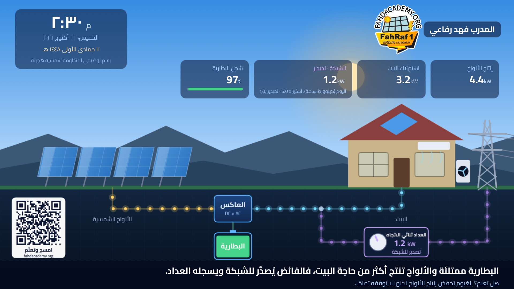

# محطة الطاقة الحيّة · Live Power Station Screensaver
**المدرب فهد رفاعي — [fahdacademy.org](https://fahdacademy.org)**

شاشة توقف تعليمية لمنظومة شمسية **هجينة** (ألواح + بطارية + شبكة وعدّاد ثنائي الاتجاه) تتفاعل مع وقت اليوم.
تعمل على **سامسونج، أندرويد/جوجل TV، LG، ماك، ويندوز** — مجانًا وبدون إنترنت وبدون جمع أي بيانات.

## ثبّتها بمساعدة الذكاء الاصطناعي (بدون ما تنزّل شيئًا بنفسك)

أرسل رابط هذا المشروع لمساعدك الذكي (Claude أو Codex أو ChatGPT أو أي وكيل) مع هذه الجملة:

> ثبّت لي مشروع GitHub هذا على شاشتي: https://github.com/refaeefa/live-power-station — اقرأ الملف AI-INSTALL-GUIDE.md وامشِ معي خطوة خطوة.

هو ينزّل المشروع بنفسه ويسألك أسئلة بسيطة (نوع الشاشة، عنوان IP…) ويطلب منك ضغطات قليلة بالريموت. أنت فقط تتابع.

> **لا تحتاج أن تحدد نوع شاشتك في الجملة.** المساعد يسألك أول شيء: ما نوع شاشتك؟ ثم يمشي بك على الطريقة المناسبة.

### ما الذي سيحدث لكل جهاز؟

| جهازك | ما يفعله المساعد | ما المطلوب منك |
|---|---|---|
| **كمبيوتر ماك أو ويندوز** | يشغّلها بملء الشاشة بنقرة واحدة | لا شيء تقريبًا (دقيقة واحدة) |
| **أي شاشة بمتصفح** | يفتحها في المتصفح بملء الشاشة | لا شيء |
| **شاشة سامسونج** (Tizen) | يثبّت أدوات سامسونج، ويربط الشاشة، ويوقّع التطبيق ويثبّته | تفعيل وضع المطور بالريموت، وتسجيل الدخول بحساب سامسونج مرة واحدة، وكتابة كلمة مرور الشهادة بنفسك |
| **شاشة TCL أو سوني أو شاومي أو هايسنس** (Android TV / Google TV) | يبني التطبيق ويثبّته عبر الشبكة | تفعيل خيار التصحيح (Developer options) من إعدادات الشاشة |
| **شاشة LG** (webOS) | يوجّهك — تجريبي | تفعيل Developer Mode في الشاشة وتجديده كل فترة |

ملاحظة: شاشات TCL المبنية على Roku وشاشات Fire TV وVizio غير مدعومة بالتثبيت المباشر، وسيعرض عليك المساعد فتحها من المتصفح كبديل.

التثبيت اليدوي بالصور: [guide/FahdSolarSaver-Guide-AR.pdf](guide/FahdSolarSaver-Guide-AR.pdf)

---

## English
Send this repo link to any AI agent (Claude Code, Codex, ChatGPT…) and say:
*"Install this GitHub project on my screen: https://github.com/refaeefa/live-power-station — read AI-INSTALL-GUIDE.md and guide me step by step."*

An educational full-screen animation of a hybrid solar system (PV + battery + grid with a bidirectional meter) driven by your device clock.
Runs offline; collects no data. Supports Samsung (Tizen), Android/Google TV, LG (webOS, experimental), macOS, Windows, and any modern browser.

License: CC BY-NC-ND 4.0 — see [LICENSE](LICENSE).
